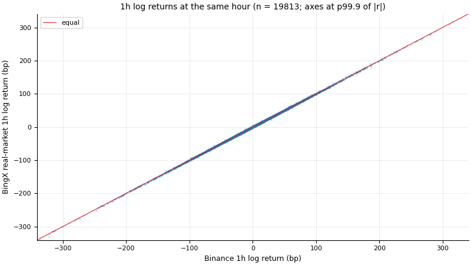
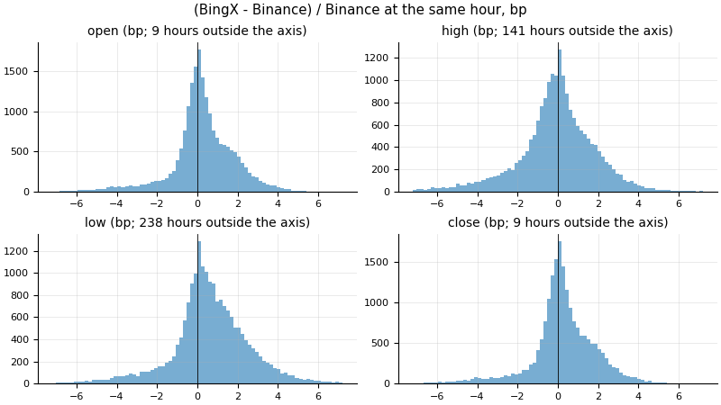
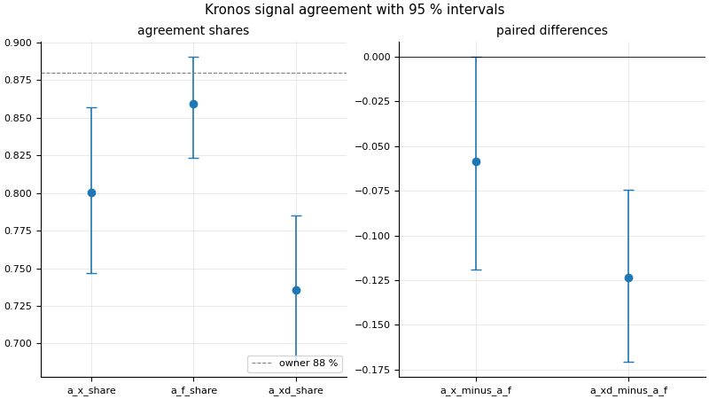

# Binance vs BingX real-market mismatch

Study 3 of docs/DATA.md (SPEC section 5): every hour present in both sources from 2024-04-27T10:00Z to the sealed start. Contemporaneous candles of two venues; no validation outcome is involved.

- Study: `mismatch`; config sha256 `a28566165d67787d156bdab6cb773b77b93eb8ae788a17e2795e0f4de5aa91bf`; docs/DATA.md sha256 `ddfca5a24e0c43bda78ea9bdc60331ebc2e65a40aabec187552956ee8d55a306`
- Code: commit `3cda6c6b125e573dd764f1dc1bd1510602da7711`, dirty yes, source tree sha256 `25c1e652e814de3ac4a5948cee4b5315cecebe57a01ada1784b985fcc4a24472`
- Generated at 2026-11-02T16:17:31Z
- Tests consumed: 0 (this study measures the data, not a strategy, and looks at no trade outcome)
- Statistics with intervals: 54; expected to miss their true value by chance at 95 %: 2.7
- Intervals: 95 % percentile block bootstrap, 1000 resamples; blocks: calendar weeks starting Monday 00:00 UTC (hourly series), groups of 4 calendar weeks (Monday 00:00 UTC grid) (Kronos sample hours); seed key `mismatch/<section>/<statistic>` (listed in the JSON report)

## Samples

- Hours [2024-04-27T10:00Z, 2026-08-01T00:00Z): eligible 19814, used 19814, excluded 0
- Returns: 19813 hours, lost 1 (the hour t - 1h is missing in a source (no return at t))
- Excluded (the hour t - 1h is missing in a source (no return at t)): 1 hours: [2024-04-27T10:00Z, 2024-04-27T11:00Z)
- Volume ratio (descriptive): 19813 of 19814 hours
- Excluded (zero Binance volume (median_ratio undefined)): 1 hours: [2024-10-28T20:00Z, 2024-10-28T21:00Z)
- Amount proxy e_t: eligible 19814 Binance hours, used 19813
- Excluded (zero quote volume (e_t undefined)): 1 hours: [2024-10-28T20:00Z, 2024-10-28T21:00Z)
- Amount proxy dz: Kronos sample hours used 291 of 291

## Alignment (1h log returns at lags -2..+2 h)

| statistic | point | 95 % interval | n | blocks | method / note | comparator |
| --- | --- | --- | --- | --- | --- | --- |
| lag_minus_2 | -0.0008775 | [-0.02027, 0.01628] | 19811 | 119 | percentile_block_bootstrap | lag_0 |
| lag_minus_1 | -0.01665 | [-0.04029, 0.006214] | 19812 | 119 | percentile_block_bootstrap | lag_0 |
| lag_0 | 0.9998 | n/a | 19813 | 119 | point_only; lag 0 is returns/pearson (the same rows): its interval is reported there | lag_minus_2 .. lag_plus_2 |
| lag_plus_1 | -0.01605 | [-0.03684, 0.007201] | 19812 | 119 | percentile_block_bootstrap | lag_0 |
| lag_plus_2 | -0.0008431 | [-0.01853, 0.01743] | 19811 | 119 | percentile_block_bootstrap | lag_0 |

Lag 0 is the largest: yes.

## Returns

| statistic | point | 95 % interval | n | blocks | method / note | comparator |
| --- | --- | --- | --- | --- | --- | --- |
| pearson | 0.9998 | [0.9998, 0.9999] | 19813 | 119 | percentile_block_bootstrap | alignment/lag_minus_1 and alignment/lag_plus_1 |
| spearman | 0.9997 | [0.9996, 0.9997] | 19813 | 119 | percentile_block_bootstrap | alignment/lag_minus_1 and alignment/lag_plus_1 |
| diff_std_bp | 0.8886 | [0.8506, 0.9277] | 19813 | 119 | percentile_block_bootstrap | binance_std_bp |
| diff_mad_bp | 0.4641 | [0.4492, 0.4826] | 19813 | 119 | percentile_block_bootstrap | binance_std_bp |
| binance_std_bp | 49.65 | [46.67, 53.08] | 19813 | 119 | percentile_block_bootstrap | the comparator of diff_std_bp and diff_mad_bp (the scale of the hourly return) |
| diff_std_ratio | 0.0179 | [0.01694, 0.01894] | 19813 | 119 | percentile_block_bootstrap | 1 |
| diff_mad_ratio | 0.009347 | [0.008757, 0.01001] | 19813 | 119 | percentile_block_bootstrap | 1 |
- one_minus_pearson: 0.0001595 [0.0001424, 0.0001774] (transform of mismatch/returns/pearson)
- one_minus_spearman: 0.0003276 [0.0002962, 0.0003625] (transform of mismatch/returns/spearman)

## Prices: (BingX - Binance) / Binance in bp

| statistic | point | 95 % interval | n | blocks | method / note | comparator |
| --- | --- | --- | --- | --- | --- | --- |
| open_signed_bp_mean | 0.2702 | [0.05265, 0.4952] | 19814 | 119 | percentile_block_bootstrap | tick_bp_median, abs_return_bp_median and SPEC 0.05 bp |
| open_signed_bp_median | 0.2039 | [0.09578, 0.3514] | 19814 | 119 | percentile_block_bootstrap | tick_bp_median, abs_return_bp_median and SPEC 0.05 bp |
| open_abs_bp_mean | 1.117 | [0.9639, 1.289] | 19814 | 119 | percentile_block_bootstrap | tick_bp_median, abs_return_bp_median and SPEC 0.05 bp |
| open_abs_bp_median | 0.7017 | [0.5925, 0.853] | 19814 | 119 | percentile_block_bootstrap | tick_bp_median, abs_return_bp_median and SPEC 0.05 bp |
| open_equal_share | 0.006359 | [0.004945, 0.007823] | 19814 | 119 | percentile_block_bootstrap; n_eff 1.18e+04 | SPEC section 5 (external reference) |
| high_signed_bp_mean | -0.1337 | [-0.3527, 0.09441] | 19814 | 119 | percentile_block_bootstrap | tick_bp_median, abs_return_bp_median and SPEC 0.05 bp |
| high_signed_bp_median | 0 | [-0.1646, 0.1298] | 19814 | 119 | percentile_block_bootstrap | tick_bp_median, abs_return_bp_median and SPEC 0.05 bp |
| high_abs_bp_mean | 1.438 | [1.307, 1.585] | 19814 | 119 | percentile_block_bootstrap | tick_bp_median, abs_return_bp_median and SPEC 0.05 bp |
| high_abs_bp_median | 0.979 | [0.8792, 1.117] | 19814 | 119 | percentile_block_bootstrap | tick_bp_median, abs_return_bp_median and SPEC 0.05 bp |
| high_equal_share | 0.0104 | [0.008874, 0.01184] | 19814 | 119 | percentile_block_bootstrap; n_eff 1.644e+04 | SPEC section 5 (external reference) |
| low_signed_bp_mean | 0.7505 | [0.5143, 0.9854] | 19814 | 119 | percentile_block_bootstrap | tick_bp_median, abs_return_bp_median and SPEC 0.05 bp |
| low_signed_bp_median | 0.5735 | [0.4158, 0.7563] | 19814 | 119 | percentile_block_bootstrap | tick_bp_median, abs_return_bp_median and SPEC 0.05 bp |
| low_abs_bp_mean | 1.588 | [1.461, 1.714] | 19814 | 119 | percentile_block_bootstrap | tick_bp_median, abs_return_bp_median and SPEC 0.05 bp |
| low_abs_bp_median | 1.083 | [0.9461, 1.248] | 19814 | 119 | percentile_block_bootstrap | tick_bp_median, abs_return_bp_median and SPEC 0.05 bp |
| low_equal_share | 0.01075 | [0.008974, 0.01257] | 19814 | 119 | percentile_block_bootstrap; n_eff 1.292e+04 | SPEC section 5 (external reference) |
| close_signed_bp_mean | 0.2714 | [0.05035, 0.4868] | 19814 | 119 | percentile_block_bootstrap | tick_bp_median, abs_return_bp_median and SPEC 0.05 bp |
| close_signed_bp_median | 0.2039 | [0.09191, 0.3383] | 19814 | 119 | percentile_block_bootstrap | tick_bp_median, abs_return_bp_median and SPEC 0.05 bp |
| close_abs_bp_mean | 1.129 | [0.965, 1.305] | 19814 | 119 | percentile_block_bootstrap | tick_bp_median, abs_return_bp_median and SPEC 0.05 bp |
| close_abs_bp_median | 0.7128 | [0.5931, 0.8661] | 19814 | 119 | percentile_block_bootstrap | tick_bp_median, abs_return_bp_median and SPEC 0.05 bp |
| close_equal_share | 0.006914 | [0.005365, 0.008435] | 19814 | 119 | percentile_block_bootstrap; n_eff 1.138e+04 | SPEC section 5 (external reference) |
| abs_return_bp_median | 21.03 | [19.93, 22.17] | 19813 | 119 | percentile_block_bootstrap | the comparator of the price differences (the typical hourly move) |

Descriptive (no interval): open_abs_bp_p90 2.691, open_abs_bp_p99 5.018, open_abs_bp_max 10, high_abs_bp_p90 3.247, high_abs_bp_p99 6.718, high_abs_bp_max 32.04, low_abs_bp_p90 3.542, low_abs_bp_p99 7.682, low_abs_bp_max 81.8, close_abs_bp_p90 2.721, close_abs_bp_p99 5.09, close_abs_bp_max 9.976, tick_bp_median 0.01185.
- External reference: SPEC section 5 demo-vs-real median 0.05 bp.

## Volume

| statistic | point | 95 % interval | n | blocks | method / note | comparator |
| --- | --- | --- | --- | --- | --- | --- |
| spearman | 0.8307 | [0.807, 0.8559] | 19814 | 119 | percentile_block_bootstrap | spearman_lag_minus_1 and spearman_lag_plus_1 |
| spearman_lag_minus_1 | 0.6198 | [0.5957, 0.6427] | 19813 | 119 | percentile_block_bootstrap | the comparator of volume/spearman |
| spearman_lag_plus_1 | 0.5961 | [0.571, 0.6193] | 19813 | 119 | percentile_block_bootstrap | the comparator of volume/spearman |

Descriptive (no interval): median_ratio 0.1157.

## amount proxy (question 9)

| statistic | point | 95 % interval | n | blocks | method / note | comparator |
| --- | --- | --- | --- | --- | --- | --- |
| e_bp_mean | 0.2182 | [0.04625, 0.3837] | 19813 | 119 | percentile_block_bootstrap | 0 bp |
| e_bp_median | 0.07771 | [-0.01649, 0.1873] | 19813 | 119 | percentile_block_bootstrap | 0 bp |
| dz_proxy_median_mean | 0.0006161 | [0.0005109, 0.0007301] | 291 | 28 | percentile_block_bootstrap | dz_volume_* |
| dz_proxy_max_mean | 0.02556 | [0.02255, 0.02872] | 291 | 28 | percentile_block_bootstrap | dz_volume_* |
| dz_volume_median_mean | 0.1281 | [0.1143, 0.1425] | 291 | 28 | percentile_block_bootstrap | the comparator of the dz_proxy statistics |
| dz_volume_max_mean | 1.937 | [1.745, 2.121] | 291 | 28 | percentile_block_bootstrap | the comparator of the dz_proxy statistics |
| dz_median_difference | -0.1275 | [-0.142, -0.1138] | 291 | 28 | percentile_block_bootstrap | 0 |
| dz_max_difference | -1.912 | [-2.118, -1.716] | 291 | 28 | percentile_block_bootstrap | 0 |

Descriptive (no interval): abs_e_bp_median 4.41, abs_e_bp_p90 15.26, abs_e_bp_p99 36.81, abs_e_bp_max 123.9, dz_proxy_max_max 0.07365, dz_volume_max_max 4.235.

## Kronos signal agreement

Design `primary`: 291 of 291 sample hours with the three fans; 873 fans (873 computed, 0 reused), forecast config `b2723b9626339a08`.

This run: gate-3 estimate 5590 CPU-seconds (873 pending fans x 3.202 s x 2 threads).

Gate-3 records of these fans' forecast config (mismatch.gate3.jsonl beside this report, appended before each batch's first fan): 1
- primary sample: the owner approved 1.53 CPU-hours (--approved-by-owner given at 2026-11-02T15:31:59Z); measured 1.553 CPU-hours, 1.015 times the approved figure (at most 1.25); estimate 5590 CPU-seconds (873 pending fans x 3.202 s x 2 threads); 0 tasks dropped
- The fans took 2.157e+04 CPU-seconds of model time in all (gate-3 limit 3600 per batch)

| statistic | point | 95 % interval | n | blocks | method / note | comparator |
| --- | --- | --- | --- | --- | --- | --- |
| a_x_share | 0.8007 | [0.7468, 0.8567] | 291 | 28 | percentile_block_bootstrap; n_eff 219.5 | a_f_share |
| a_f_share | 0.8591 | [0.8231, 0.8905] | 291 | 28 | percentile_block_bootstrap; n_eff 403.3 | the owner's two-seed floor of 88 % (SPEC section 5, external reference) |
| a_xd_share | 0.7354 | [0.6879, 0.7849] | 291 | 28 | percentile_block_bootstrap; n_eff 325.5 | a_f_share |
| a_x_minus_a_f | -0.05842 | [-0.119, 0] | 291 | 28 | percentile_block_bootstrap | 0, with the pre-registered reading and the minimum detectable difference at 80 % power |
| a_xd_minus_a_f | -0.1237 | [-0.1707, -0.0742] | 291 | 28 | percentile_block_bootstrap | 0, with the pre-registered reading and the minimum detectable difference at 80 % power |
| p_up_x_correlation | 0.7829 | [0.7223, 0.843] | 291 | 28 | percentile_block_bootstrap | p_up_f_* |
| p_up_x_abs_delta_mean | 0.1241 | [0.1087, 0.1395] | 291 | 28 | percentile_block_bootstrap | p_up_f_* |
| p_up_f_correlation | 0.8387 | [0.8063, 0.8677] | 291 | 28 | percentile_block_bootstrap | the comparator of the other p_up pairs |
| p_up_f_abs_delta_mean | 0.1098 | [0.09929, 0.1212] | 291 | 28 | percentile_block_bootstrap | the comparator of the other p_up pairs |
| p_up_xd_correlation | 0.693 | [0.6332, 0.7453] | 291 | 28 | percentile_block_bootstrap | p_up_f_* |
| p_up_xd_abs_delta_mean | 0.1555 | [0.1457, 0.1662] | 291 | 28 | percentile_block_bootstrap | p_up_f_* |

External reference: the owner's two-seed floor of 0.88.
- Reading of a_x_minus_a_f (pre-registered): **not distinguishable** (interval contains 0; minimum detectable difference 0.08502; planned about 9 points at 291 hours (docs/DATA.md))
- Reading of a_xd_minus_a_f (pre-registered): **the sources shift the signal beyond seed noise** (interval entirely below 0; minimum detectable difference 0.06894; planned about 9 points at 291 hours (docs/DATA.md))
- Autocorrelation of the a_x flags: lag 1 -0.07752, lag 2 0.05512, lag 3 -0.01034, lag 4 0.09647, lag 5 -0.07235, lag 6 0.01721, lag 7 0.01636, lag 8 0.05857
- Autocorrelation of the a_f flags: lag 1 0.005778, lag 2 0.0376, lag 3 -0.04813, lag 4 -0.0203, lag 5 0.007524, lag 6 -0.02143, lag 7 -0.1032, lag 8 -0.04695
- Autocorrelation of the a_xd flags: lag 1 -0.09615, lag 2 0.04389, lag 3 -0.09862, lag 4 0.07674, lag 5 0.009536, lag 6 0.04829, lag 7 -0.01891, lag 8 0.01517

## Comparators

- alignment/lag_minus_2: lag_0: the aligned correlation (returns/pearson), which must be the largest of the five lags or the report fails
- alignment/lag_minus_1: lag_0: the aligned correlation (returns/pearson), which must be the largest of the five lags or the report fails
- alignment/lag_0: lag_minus_2 .. lag_plus_2: the same correlation out of alignment; lag 0 must be larger than every one of them or the report fails
- alignment/lag_plus_1: lag_0: the aligned correlation (returns/pearson), which must be the largest of the five lags or the report fails
- alignment/lag_plus_2: lag_0: the aligned correlation (returns/pearson), which must be the largest of the five lags or the report fails
- returns/pearson: alignment/lag_minus_1 and alignment/lag_plus_1: the correlation of the same returns one hour out of alignment
- returns/spearman: alignment/lag_minus_1 and alignment/lag_plus_1: the correlation of the same returns one hour out of alignment
- returns/diff_std_bp: binance_std_bp: the standard deviation of r_binance itself
- returns/diff_mad_bp: binance_std_bp: the standard deviation of r_binance itself
- returns/binance_std_bp: the comparator of diff_std_bp and diff_mad_bp (the scale of the hourly return)
- returns/diff_std_ratio: 1: a venue difference as large as the hourly return itself
- returns/diff_mad_ratio: 1: a venue difference as large as the hourly return itself
- prices/open_signed_bp_mean: tick_bp_median, abs_return_bp_median and SPEC 0.05 bp: one 0.1 USDT tick in bp of the Binance close, the median |1h return| of Binance in bp, and SPEC section 5's demo-vs-real median close difference of 0.05 bp (external reference)
- prices/open_signed_bp_median: tick_bp_median, abs_return_bp_median and SPEC 0.05 bp: one 0.1 USDT tick in bp of the Binance close, the median |1h return| of Binance in bp, and SPEC section 5's demo-vs-real median close difference of 0.05 bp (external reference)
- prices/open_abs_bp_mean: tick_bp_median, abs_return_bp_median and SPEC 0.05 bp: one 0.1 USDT tick in bp of the Binance close, the median |1h return| of Binance in bp, and SPEC section 5's demo-vs-real median close difference of 0.05 bp (external reference)
- prices/open_abs_bp_median: tick_bp_median, abs_return_bp_median and SPEC 0.05 bp: one 0.1 USDT tick in bp of the Binance close, the median |1h return| of Binance in bp, and SPEC section 5's demo-vs-real median close difference of 0.05 bp (external reference)
- prices/open_equal_share: SPEC section 5 (external reference): since 2024-07-26 no 1h candle of the demo account equals the real one
- prices/high_signed_bp_mean: tick_bp_median, abs_return_bp_median and SPEC 0.05 bp: one 0.1 USDT tick in bp of the Binance close, the median |1h return| of Binance in bp, and SPEC section 5's demo-vs-real median close difference of 0.05 bp (external reference)
- prices/high_signed_bp_median: tick_bp_median, abs_return_bp_median and SPEC 0.05 bp: one 0.1 USDT tick in bp of the Binance close, the median |1h return| of Binance in bp, and SPEC section 5's demo-vs-real median close difference of 0.05 bp (external reference)
- prices/high_abs_bp_mean: tick_bp_median, abs_return_bp_median and SPEC 0.05 bp: one 0.1 USDT tick in bp of the Binance close, the median |1h return| of Binance in bp, and SPEC section 5's demo-vs-real median close difference of 0.05 bp (external reference)
- prices/high_abs_bp_median: tick_bp_median, abs_return_bp_median and SPEC 0.05 bp: one 0.1 USDT tick in bp of the Binance close, the median |1h return| of Binance in bp, and SPEC section 5's demo-vs-real median close difference of 0.05 bp (external reference)
- prices/high_equal_share: SPEC section 5 (external reference): since 2024-07-26 no 1h candle of the demo account equals the real one
- prices/low_signed_bp_mean: tick_bp_median, abs_return_bp_median and SPEC 0.05 bp: one 0.1 USDT tick in bp of the Binance close, the median |1h return| of Binance in bp, and SPEC section 5's demo-vs-real median close difference of 0.05 bp (external reference)
- prices/low_signed_bp_median: tick_bp_median, abs_return_bp_median and SPEC 0.05 bp: one 0.1 USDT tick in bp of the Binance close, the median |1h return| of Binance in bp, and SPEC section 5's demo-vs-real median close difference of 0.05 bp (external reference)
- prices/low_abs_bp_mean: tick_bp_median, abs_return_bp_median and SPEC 0.05 bp: one 0.1 USDT tick in bp of the Binance close, the median |1h return| of Binance in bp, and SPEC section 5's demo-vs-real median close difference of 0.05 bp (external reference)
- prices/low_abs_bp_median: tick_bp_median, abs_return_bp_median and SPEC 0.05 bp: one 0.1 USDT tick in bp of the Binance close, the median |1h return| of Binance in bp, and SPEC section 5's demo-vs-real median close difference of 0.05 bp (external reference)
- prices/low_equal_share: SPEC section 5 (external reference): since 2024-07-26 no 1h candle of the demo account equals the real one
- prices/close_signed_bp_mean: tick_bp_median, abs_return_bp_median and SPEC 0.05 bp: one 0.1 USDT tick in bp of the Binance close, the median |1h return| of Binance in bp, and SPEC section 5's demo-vs-real median close difference of 0.05 bp (external reference)
- prices/close_signed_bp_median: tick_bp_median, abs_return_bp_median and SPEC 0.05 bp: one 0.1 USDT tick in bp of the Binance close, the median |1h return| of Binance in bp, and SPEC section 5's demo-vs-real median close difference of 0.05 bp (external reference)
- prices/close_abs_bp_mean: tick_bp_median, abs_return_bp_median and SPEC 0.05 bp: one 0.1 USDT tick in bp of the Binance close, the median |1h return| of Binance in bp, and SPEC section 5's demo-vs-real median close difference of 0.05 bp (external reference)
- prices/close_abs_bp_median: tick_bp_median, abs_return_bp_median and SPEC 0.05 bp: one 0.1 USDT tick in bp of the Binance close, the median |1h return| of Binance in bp, and SPEC section 5's demo-vs-real median close difference of 0.05 bp (external reference)
- prices/close_equal_share: SPEC section 5 (external reference): since 2024-07-26 no 1h candle of the demo account equals the real one
- prices/abs_return_bp_median: the comparator of the price differences (the typical hourly move)
- prices/open_abs_bp_p90: tick_bp_median, abs_return_bp_median and SPEC 0.05 bp: one 0.1 USDT tick in bp of the Binance close, the median |1h return| of Binance in bp, and SPEC section 5's demo-vs-real median close difference of 0.05 bp (external reference)
- prices/open_abs_bp_p99: tick_bp_median, abs_return_bp_median and SPEC 0.05 bp: one 0.1 USDT tick in bp of the Binance close, the median |1h return| of Binance in bp, and SPEC section 5's demo-vs-real median close difference of 0.05 bp (external reference)
- prices/open_abs_bp_max: tick_bp_median, abs_return_bp_median and SPEC 0.05 bp: one 0.1 USDT tick in bp of the Binance close, the median |1h return| of Binance in bp, and SPEC section 5's demo-vs-real median close difference of 0.05 bp (external reference)
- prices/high_abs_bp_p90: tick_bp_median, abs_return_bp_median and SPEC 0.05 bp: one 0.1 USDT tick in bp of the Binance close, the median |1h return| of Binance in bp, and SPEC section 5's demo-vs-real median close difference of 0.05 bp (external reference)
- prices/high_abs_bp_p99: tick_bp_median, abs_return_bp_median and SPEC 0.05 bp: one 0.1 USDT tick in bp of the Binance close, the median |1h return| of Binance in bp, and SPEC section 5's demo-vs-real median close difference of 0.05 bp (external reference)
- prices/high_abs_bp_max: tick_bp_median, abs_return_bp_median and SPEC 0.05 bp: one 0.1 USDT tick in bp of the Binance close, the median |1h return| of Binance in bp, and SPEC section 5's demo-vs-real median close difference of 0.05 bp (external reference)
- prices/low_abs_bp_p90: tick_bp_median, abs_return_bp_median and SPEC 0.05 bp: one 0.1 USDT tick in bp of the Binance close, the median |1h return| of Binance in bp, and SPEC section 5's demo-vs-real median close difference of 0.05 bp (external reference)
- prices/low_abs_bp_p99: tick_bp_median, abs_return_bp_median and SPEC 0.05 bp: one 0.1 USDT tick in bp of the Binance close, the median |1h return| of Binance in bp, and SPEC section 5's demo-vs-real median close difference of 0.05 bp (external reference)
- prices/low_abs_bp_max: tick_bp_median, abs_return_bp_median and SPEC 0.05 bp: one 0.1 USDT tick in bp of the Binance close, the median |1h return| of Binance in bp, and SPEC section 5's demo-vs-real median close difference of 0.05 bp (external reference)
- prices/close_abs_bp_p90: tick_bp_median, abs_return_bp_median and SPEC 0.05 bp: one 0.1 USDT tick in bp of the Binance close, the median |1h return| of Binance in bp, and SPEC section 5's demo-vs-real median close difference of 0.05 bp (external reference)
- prices/close_abs_bp_p99: tick_bp_median, abs_return_bp_median and SPEC 0.05 bp: one 0.1 USDT tick in bp of the Binance close, the median |1h return| of Binance in bp, and SPEC section 5's demo-vs-real median close difference of 0.05 bp (external reference)
- prices/close_abs_bp_max: tick_bp_median, abs_return_bp_median and SPEC 0.05 bp: one 0.1 USDT tick in bp of the Binance close, the median |1h return| of Binance in bp, and SPEC section 5's demo-vs-real median close difference of 0.05 bp (external reference)
- prices/tick_bp_median: the comparator of the price differences (the price grid)
- volume/spearman: spearman_lag_minus_1 and spearman_lag_plus_1: the same correlation one hour out of alignment
- volume/spearman_lag_minus_1: the comparator of volume/spearman
- volume/spearman_lag_plus_1: the comparator of volume/spearman
- volume/median_ratio: none: descriptive, the two venues may count volume in different units
- amount/e_bp_mean: 0 bp: an exact proxy; its effect on the model input is dz_* against dz_volume_* (the cross-venue difference of the volume channel)
- amount/e_bp_median: 0 bp: an exact proxy; its effect on the model input is dz_* against dz_volume_* (the cross-venue difference of the volume channel)
- amount/dz_proxy_median_mean: dz_volume_*: the same dz for the volume channel between the Binance and BingX windows at the same hours
- amount/dz_proxy_max_mean: dz_volume_*: the same dz for the volume channel between the Binance and BingX windows at the same hours
- amount/dz_volume_median_mean: the comparator of the dz_proxy statistics
- amount/dz_volume_max_mean: the comparator of the dz_proxy statistics
- amount/dz_median_difference: 0: the proxy moves the model input as much as the venue does
- amount/dz_max_difference: 0: the proxy moves the model input as much as the venue does
- amount/abs_e_bp_median: 0 bp: an exact proxy; its effect on the model input is dz_* against dz_volume_* (the cross-venue difference of the volume channel)
- amount/abs_e_bp_p90: 0 bp: an exact proxy; its effect on the model input is dz_* against dz_volume_* (the cross-venue difference of the volume channel)
- amount/abs_e_bp_p99: 0 bp: an exact proxy; its effect on the model input is dz_* against dz_volume_* (the cross-venue difference of the volume channel)
- amount/abs_e_bp_max: 0 bp: an exact proxy; its effect on the model input is dz_* against dz_volume_* (the cross-venue difference of the volume channel)
- amount/dz_proxy_max_max: dz_volume_*: the same dz for the volume channel between the Binance and BingX windows at the same hours
- amount/dz_volume_max_max: the comparator of the dz_proxy statistics
- kronos/a_x_share: a_f_share: the agreement of two seeds on the same BingX window
- kronos/a_f_share: the owner's two-seed floor of 88 % (SPEC section 5, external reference)
- kronos/a_xd_share: a_f_share: the agreement of two seeds on the same BingX window
- kronos/a_x_minus_a_f: 0, with the pre-registered reading and the minimum detectable difference at 80 % power
- kronos/a_xd_minus_a_f: 0, with the pre-registered reading and the minimum detectable difference at 80 % power
- kronos/p_up_x_correlation: p_up_f_*: the floor pair (the same BingX window under two seeds)
- kronos/p_up_x_abs_delta_mean: p_up_f_*: the floor pair (the same BingX window under two seeds)
- kronos/p_up_f_correlation: the comparator of the other p_up pairs
- kronos/p_up_f_abs_delta_mean: the comparator of the other p_up pairs
- kronos/p_up_xd_correlation: p_up_f_*: the floor pair (the same BingX window under two seeds)
- kronos/p_up_xd_abs_delta_mean: p_up_f_*: the floor pair (the same BingX window under two seeds)

## Series, figures and data

- Series hours `studies/mismatch_hours.csv` (relative to the data root): 19814 rows, sha256 `5464d340f9ee52306212fd569df00cce65ea7f50db3f93b4acb677c7b3e5c083`
- Series amount `studies/mismatch_amount.csv` (relative to the data root): 19814 rows, sha256 `0d14886725be33118985d0d69054ae5676309f66ee17f8e9260a5fd490ac0afd`
- Series amount_windows `studies/mismatch_amount_windows.csv` (relative to the data root): 291 rows, sha256 `8a82ecb5c1cd5fe7f2ff7abf51a72492ddbfae2e05e5848705bda940dc0f3437`
- Series kronos `studies/mismatch_kronos.csv` (relative to the data root): 291 rows, sha256 `caff32aeaf25721416e53ac628a081644eda066e0771166b2391a6d265a783c7`
-  sha256 `52542e9ea50bc1215e919af05a2b22ba05ec726af737b72eb5a8df6323aa2272`
-  sha256 `e8c2c52c82bafc33eb3b9559dbefbe91f830dc73aecb0a7cf3ecb00b9121ae7b`
-  sha256 `2c24143b1e8a2c66db46db56be9f9b33e2edea35832a426b92d788f7624995c0`
- Store `candles/binance/1h.csv` csv sha256 `9a04ce60f1f5ddf6c3e93cc4cc1064b2203d37f2858c30a755c71c049bb05f14`; read [2024-04-27T10:00Z, 2026-08-01T00:00Z), 19814 rows
- Store `candles/bingx/1h.csv` csv sha256 `9c47de782cd66b7b89c6554f5cc9285b8c7e5b362f5fdf38e551ef30d15afeee`; read [2024-04-27T10:00Z, 2026-08-01T00:00Z), 19814 rows
