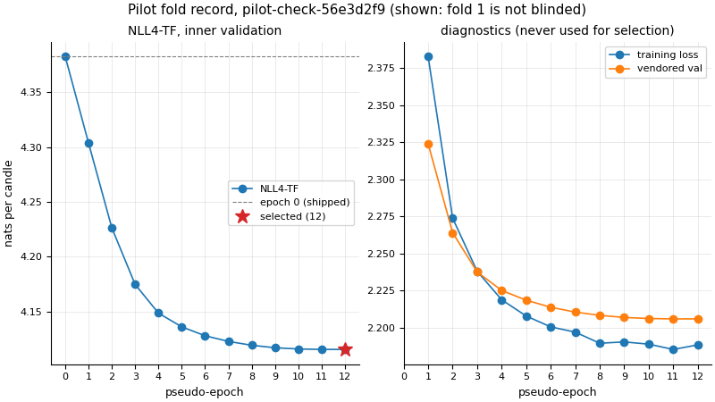

# Pilot check, pilot-check-56e3d2f9

Design: docs/RETRAINING.md 6.2 steps 3-4. A study with 0 tests on training-segment hours, under the named model-period opt-in 'pilot-check' (docs/RETRAINING.md 6.2): the shipped weights forecast hours before their cutoff and the pilot hours inside its own inner validation, training-segment hours where no skill is read.

## Reading: GO

A_same = 0.75 against the pre-registered threshold 0.98 (NO-GO when a_same >= 0.98 (included)).

## Provenance

- Study `pilot-check-56e3d2f9`; config sha256 `110f190617541a58a4f6072bf7918ae5bf229c61bd68d800b57cc9070d50365b`; docs/RETRAINING.md sha256 `412583e42ac69eea7fd0f580669e1b29d90abaf58255bb2f931f0e522c215d96`
- Code: commit `720e03adebf49c4ab531b775fab33d4ab33955e7`, dirty yes, source tree sha256 `51796efd12230d8b0ae100710cd216a8adaa3dad978397af26d6985725f52bf8`; params version `4dcb783980a9`
- Recipe R1 `56e3d2f9b0a342ce86a612bf6a07a5f71ba62cd99c5dbc126bc3a85e91563718` (max_epochs 12); fold q-2024-07, CSV [2020-01-01T00:00Z, 2024-06-09T16:00Z), inner validation from 2024-04-14T16:00Z
- Checkpoint `ks-btc-56e3d2f9-q-2024-07`, registry line sha256 `3bd014876bce7f236f4458ecb93341a86855eb42e71186a2bbd65e077bda8f39`, data end 2024-06-09T16:00Z; files config.json `5e0f6a605d5f81b5c9b559fe5cf716a1acb041c744e6f41bd05b097b7a685396`, model.safetensors `97bdf4492ab57ac4052b97e6720c668479546c45fdc3fe62f9ebf870b794a4ef`
- Fold record sha256 `287f694e24faf2fd8f284759e48ace5dfe2ab33624fae3d3ba9a9e32cb5b3e84`; export content sha256 `c23dd753ebb6cb1e857a96ab74f8e0c9e1a472ffb04439a709f32cbc93c75e31`
- Generated at 2026-11-04T12:41:20Z; tests consumed 0; statistics with intervals 0: the decisions touch 3 four-week blocks, fewer than the 20 an interval needs (D-035): point estimates only
- Run: spend 3726 CPU-seconds (103.7 in this run and 3622 in the stopped runs before it; wall 51.84 s) against a limit of 4950 (1.1 CPU-hours approved) (design 3.5)

## Decisions and fans

168 of 168 G8 decisions kept, 2024-04-14T16:00Z .. 2024-06-09T08:00Z; 0 dropped.

| batch | model | stream | config id | fans | computed |
| --- | --- | --- | --- | --- | --- |
| pilot | ks-btc-56e3d2f9-q-2024-07 | forecast | `6d68b73f33853764` | 168 | 0 |
| shipped | Kronos-small as shipped | forecast | `62906d91f853a8e5` | 168 | 0 |
| floor | Kronos-small as shipped | forecast-aa | `62906d91f853a8e5` | 168 | 0 |

## Statistics (point estimates)

| statistic | value | note |
| --- | --- | --- |
| A_same | 0.75 | pilot and shipped, stream forecast |
| A_floor | 0.8274 | two shipped streams (seed floor) |
| mean abs delta p_up | 0.1274 | stream forecast |
| KL(pilot, shipped) | 0.1113 | primary, nats |
| KL(shipped, pilot) | 0.1285 | descriptive |
| KL max | 0.6785 | descriptive |
| relative weight change | 0.006127 | 127 of 136 tensors changed, max abs delta 0.00518 |
| mean CRPS pilot (bp) | 47.17 | h = 4 |
| mean CRPS shipped (bp) | 49.37 | h = 4 |
| d mean (bp) | -2.196 | descriptive only: no skill is read |
| d sd (bp) | 21.96 | ddof 1, 168 decisions |

Autocorrelation of d (lags 1..6): 1: -0.004435, 2: 0.0825, 3: -0.01993, 4: 0.05101, 5: 0.1843, 6: -0.02979.

Projection (approximate): inflation 1.527, n_eff 1434, se 0.58 bp, minimum detectable difference 1.625 bp (3.29 % of the mean shipped CRPS) for 4380 decisions; the 8-hour autocorrelation applied to one of the two 8-hour phases of G4, the second phase counted as adding no information, the 27 four-week blocks not modelled.

## NLL4-TF curve (fold 1 is shown, design 6.3)

| pseudo-epoch | NLL4-TF | training loss | vendored validation loss |
| --- | --- | --- | --- |
| 0 | 4.383 | n/a | n/a |
| 1 | 4.304 | 2.383 | 2.324 |
| 2 | 4.226 | 2.274 | 2.264 |
| 3 | 4.175 | 2.238 | 2.237 |
| 4 | 4.149 | 2.219 | 2.225 |
| 5 | 4.136 | 2.208 | 2.218 |
| 6 | 4.128 | 2.2 | 2.214 |
| 7 | 4.123 | 2.197 | 2.21 |
| 8 | 4.119 | 2.189 | 2.208 |
| 9 | 4.117 | 2.19 | 2.207 |
| 10 | 4.116 | 2.189 | 2.206 |
| 11 | 4.115 | 2.185 | 2.206 |
| 12 | 4.115 | 2.188 | 2.206 |

Selected pseudo-epoch 12 (max_epochs); epoch 0 is the shipped weights (a diagnostic, never selected).

## Figures

 (sha256 `56234c42f1e1ea39bfb03d2262f0d9155e26c8c5d394d2a21ee0160931ee1a88`)
