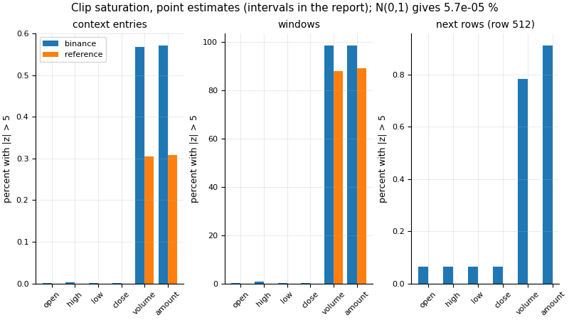
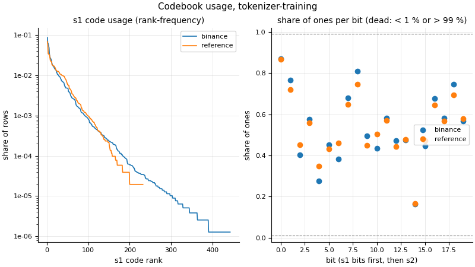

# Tokenizer diagnostic, Part A: training segment (Binance), before registration

Design: docs/RETRAINING.md section 4 (SPEC 9.1). A descriptive study with 0 tests: the tokenizer stays frozen and the clip stays 5; a flag only motivates the later, separate tokenizer test of SPEC 9.2. No automatic action follows from it.

- Study `tokenizer-training`; config sha256 `680180a66974513ed303ab5d13d9e2102ad095114674629bac3fc1595d978450`; docs/RETRAINING.md sha256 `5a0bb3e40ae3c21807f051f7e607335b7be9b687c09253157205113171b53786`; docs/DATA.md sha256 `49da6aa791a493e66d72adab9c2e8af2ede67af62006cee5228a695355df2edd`
- Code: commit `720e03adebf49c4ab531b775fab33d4ab33955e7`, dirty yes, source tree sha256 `51796efd12230d8b0ae100710cd216a8adaa3dad978397af26d6985725f52bf8`; params version `4dcb783980a9`
- Tokenizer `NeoQuasar/Kronos-Tokenizer-base` (files sha256 config.json `2366e7ccfec76cbc19cf3c4c1b9c5d901be336ca1e83f2d2292c9bff381b77a2`, model.safetensors `59d85f6af76a2c3b8240ea06cb21db4213b4eeca053f246b23e29cf832fc6bee`), s1 10 bits, s2 10 bits
- Runtime: CPU, 2 threads, deterministic yes, torch 2.14.1, 94.3 s
- Generated at 2026-11-03T16:54:33Z; tests consumed 0
- Statistics with intervals: 60; expected to miss their true value by chance at 95 %: 3
- Intervals: 95 % percentile block bootstrap, 1000 resamples, blocks of 4 calendar weeks of D; seed key `tokenizer-training/<set>/<statistic>`. p90, p99, maxima, comparators, codebook statistics and divergences are descriptive. The synthetic reference has no decision hour (one block): point estimates only.

## Windows

| set | planned | kept | dropped |
| --- | --- | --- | --- |
| binance | 1534 | 1534 | 0 |
| reference | 100 | 100 | 0 |

## Flags (pre-registered, descriptive)

- WARNING rho: binance: the return resolution rho above 0.25 (rho = 0.645, threshold 0.25)
- WARNING s1_unused_share: binance: more than half the s1 codes unused (s1 unused_share = 0.5674, threshold 0.5)

Rules (point estimates of the real sources):

- `price_saturation_context` (0.001): a price channel's share of context entries with |z| > 5 above 0.1 %
- `price_saturation_next` (0.01): a price channel's share of next rows (row 512, inference statistics) beyond +-5 above 1 % (Part A)
- `volume_amount_saturation` (0.01): the volume or amount share of context entries with |z| > 5 above 1 %
- `rho` (0.25): the return resolution rho above 0.25
- `s1_normalised_entropy` (0.5): the s1 normalised entropy below 0.5
- `s1_unused_share` (0.5): more than half the s1 codes unused
- `r1_token_mismatch` (0.05): R1's context-token mismatch above 5 % (Part A): the share of the 512 context rows whose s1 or s2 token differs from the inference encoding, which bounds the s1 share, the s2 share and their mean; the owner is told before the pre-registration bundle (D-048 (5))

## Statistics: binance

| statistic | point | 95 % interval | n | blocks | method / note |
| --- | --- | --- | --- | --- | --- |
| saturation_context_open | 6.366e-06 | [0, 1.505e-05] | 1534 | 58 | percentile_block_bootstrap |
| saturation_windows_open | 0.002608 | [0, 0.006418] | 1534 | 58 | percentile_block_bootstrap |
| saturation_next_open | 0.0006519 | [0, 0.001987] | 1534 | 58 | percentile_block_bootstrap |
| saturation_context_high | 2.037e-05 | [6.34e-06, 3.69e-05] | 1534 | 58 | percentile_block_bootstrap |
| saturation_windows_high | 0.008475 | [0.002576, 0.01632] | 1534 | 58 | percentile_block_bootstrap |
| saturation_next_high | 0.0006519 | [0, 0.001985] | 1534 | 58 | percentile_block_bootstrap |
| saturation_context_low | 5.093e-06 | [0, 1.593e-05] | 1534 | 58 | percentile_block_bootstrap |
| saturation_windows_low | 0.001304 | [0, 0.004031] | 1534 | 58 | percentile_block_bootstrap |
| saturation_next_low | 0.0006519 | [0, 0.001984] | 1534 | 58 | percentile_block_bootstrap |
| saturation_context_close | 6.366e-06 | [0, 1.551e-05] | 1534 | 58 | percentile_block_bootstrap |
| saturation_windows_close | 0.001956 | [0, 0.004502] | 1534 | 58 | percentile_block_bootstrap |
| saturation_next_close | 0.0006519 | [0, 0.001983] | 1534 | 58 | percentile_block_bootstrap |
| saturation_context_volume | 0.005676 | [0.005292, 0.006059] | 1534 | 58 | percentile_block_bootstrap |
| saturation_windows_volume | 0.987 | [0.9704, 0.9994] | 1534 | 58 | percentile_block_bootstrap |
| saturation_next_volume | 0.007823 | [0.003192, 0.01301] | 1534 | 58 | percentile_block_bootstrap |
| saturation_context_amount | 0.005722 | [0.005308, 0.006107] | 1534 | 58 | percentile_block_bootstrap |
| saturation_windows_amount | 0.985 | [0.9667, 1] | 1534 | 58 | percentile_block_bootstrap |
| saturation_next_amount | 0.009126 | [0.004507, 0.01428] | 1534 | 58 | percentile_block_bootstrap |
| rmse_open | 0.05845 | [0.05703, 0.05984] | 1534 | 58 | percentile_block_bootstrap |
| rmse_last24_open | 0.06146 | [0.05921, 0.06392] | 1534 | 58 | percentile_block_bootstrap |
| rmse_high | 0.06241 | [0.06038, 0.06453] | 1534 | 58 | percentile_block_bootstrap |
| rmse_last24_high | 0.06254 | [0.06014, 0.06489] | 1534 | 58 | percentile_block_bootstrap |
| rmse_low | 0.06786 | [0.06534, 0.07054] | 1534 | 58 | percentile_block_bootstrap |
| rmse_last24_low | 0.07151 | [0.06863, 0.0747] | 1534 | 58 | percentile_block_bootstrap |
| rmse_close | 0.05765 | [0.05627, 0.05901] | 1534 | 58 | percentile_block_bootstrap |
| rmse_last24_close | 0.05997 | [0.05816, 0.06196] | 1534 | 58 | percentile_block_bootstrap |
| rmse_volume | 0.08061 | [0.07873, 0.08288] | 1534 | 58 | percentile_block_bootstrap |
| rmse_last24_volume | 0.08606 | [0.08223, 0.09035] | 1534 | 58 | percentile_block_bootstrap |
| rmse_amount | 0.08841 | [0.08479, 0.09228] | 1534 | 58 | percentile_block_bootstrap |
| rmse_last24_amount | 0.1021 | [0.09546, 0.1092] | 1534 | 58 | percentile_block_bootstrap |
| close_error_median_abs_bp | 14.97 | [13.29, 16.67] | 785408 | 58 | percentile_block_bootstrap |
| rho | 0.645 | [0.6191, 0.6704] | 783874 | 58 | percentile_block_bootstrap |
| pre_rmse_open | 0.07588 | [0.07416, 0.07769] | 1534 | 58 | percentile_block_bootstrap |
| pre_rmse_last24_open | 0.07764 | [0.07519, 0.08029] | 1534 | 58 | percentile_block_bootstrap |
| pre_rmse_high | 0.07862 | [0.07639, 0.08091] | 1534 | 58 | percentile_block_bootstrap |
| pre_rmse_last24_high | 0.07964 | [0.0769, 0.08261] | 1534 | 58 | percentile_block_bootstrap |
| pre_rmse_low | 0.08522 | [0.08255, 0.08809] | 1534 | 58 | percentile_block_bootstrap |
| pre_rmse_last24_low | 0.08853 | [0.0854, 0.0919] | 1534 | 58 | percentile_block_bootstrap |
| pre_rmse_close | 0.07885 | [0.07704, 0.08076] | 1534 | 58 | percentile_block_bootstrap |
| pre_rmse_last24_close | 0.07952 | [0.07706, 0.08195] | 1534 | 58 | percentile_block_bootstrap |
| pre_rmse_volume | 0.1148 | [0.1124, 0.1172] | 1534 | 58 | percentile_block_bootstrap |
| pre_rmse_last24_volume | 0.1178 | [0.1118, 0.1244] | 1534 | 58 | percentile_block_bootstrap |
| pre_rmse_amount | 0.1192 | [0.1161, 0.1225] | 1534 | 58 | percentile_block_bootstrap |
| pre_rmse_last24_amount | 0.1272 | [0.1208, 0.1344] | 1534 | 58 | percentile_block_bootstrap |
| pre_close_error_median_abs_bp | 20.53 | [18.36, 22.95] | 785408 | 58 | percentile_block_bootstrap |
| pre_rho | 0.7811 | [0.7514, 0.8117] | 783874 | 58 | percentile_block_bootstrap |
| bit_margin_0.001 | 0.0002973 | [0.0002848, 0.0003096] | 1534 | 58 | percentile_block_bootstrap |
| bit_margin_0.01 | 0.00297 | [0.002881, 0.003058] | 1534 | 58 | percentile_block_bootstrap |
| mismatch_r1_s1 | 0.01144 | [0.0108, 0.01209] | 1534 | 58 | percentile_block_bootstrap |
| mismatch_r1_s1_last24 | 0.01977 | [0.01698, 0.02264] | 1534 | 58 | percentile_block_bootstrap |
| mismatch_r1_s2 | 0.008476 | [0.00796, 0.00898] | 1534 | 58 | percentile_block_bootstrap |
| mismatch_r1_s2_last24 | 0.01057 | [0.009066, 0.01214] | 1534 | 58 | percentile_block_bootstrap |
| mismatch_r1_any | 0.01852 | [0.01757, 0.01945] | 1534 | 58 | percentile_block_bootstrap |
| mismatch_r1_any_last24 | 0.02828 | [0.02478, 0.03196] | 1534 | 58 | percentile_block_bootstrap |
| mismatch_template_s1 | 0.3039 | [0.2908, 0.3171] | 1534 | 58 | percentile_block_bootstrap |
| mismatch_template_s1_last24 | 0.4033 | [0.3733, 0.4348] | 1534 | 58 | percentile_block_bootstrap |
| mismatch_template_s2 | 0.2544 | [0.2412, 0.2665] | 1534 | 58 | percentile_block_bootstrap |
| mismatch_template_s2_last24 | 0.3111 | [0.2883, 0.3355] | 1534 | 58 | percentile_block_bootstrap |
| mismatch_template_any | 0.448 | [0.4308, 0.4634] | 1534 | 58 | percentile_block_bootstrap |
| mismatch_template_any_last24 | 0.5361 | [0.5036, 0.5674] | 1534 | 58 | percentile_block_bootstrap |

Descriptive (no interval): max_abs_z_open 9.089, max_abs_z_next_open 7.997, max_abs_z_high 8.141, max_abs_z_next_high 7.694, max_abs_z_low 11.53, max_abs_z_next_low 6.527, max_abs_z_close 8.555, max_abs_z_next_close 7.201, max_abs_z_volume 17.38, max_abs_z_next_volume 15.37, max_abs_z_amount 17.62, max_abs_z_next_amount 14.54, close_error_p90_abs_bp 51.98, close_error_p99_abs_bp 127.7, close_error_max_abs_bp 1384, returns_dropped 0, pre_close_error_p90_abs_bp 71.82, pre_close_error_p99_abs_bp 175.2, pre_close_error_max_abs_bp 2321, pre_returns_dropped 0, mismatch_context_only_s1 0, mismatch_context_only_s1_last24 0, mismatch_context_only_s2 0, mismatch_context_only_s2_last24 0, mismatch_context_only_any 0, mismatch_context_only_any_last24 0, median_abs_return_bp 25.2, tick_bp 0.03402.

## Statistics: reference

| statistic | point | 95 % interval | n | blocks | method / note |
| --- | --- | --- | --- | --- | --- |
| saturation_context_open | 0 | n/a | 100 | 1 | point_only; fewer than 20 blocks (1): point estimate only |
| saturation_windows_open | 0 | n/a | 100 | 1 | point_only; fewer than 20 blocks (1): point estimate only |
| saturation_context_high | 0 | n/a | 100 | 1 | point_only; fewer than 20 blocks (1): point estimate only |
| saturation_windows_high | 0 | n/a | 100 | 1 | point_only; fewer than 20 blocks (1): point estimate only |
| saturation_context_low | 0 | n/a | 100 | 1 | point_only; fewer than 20 blocks (1): point estimate only |
| saturation_windows_low | 0 | n/a | 100 | 1 | point_only; fewer than 20 blocks (1): point estimate only |
| saturation_context_close | 0 | n/a | 100 | 1 | point_only; fewer than 20 blocks (1): point estimate only |
| saturation_windows_close | 0 | n/a | 100 | 1 | point_only; fewer than 20 blocks (1): point estimate only |
| saturation_context_volume | 0.003047 | n/a | 100 | 1 | point_only; fewer than 20 blocks (1): point estimate only |
| saturation_windows_volume | 0.88 | n/a | 100 | 1 | point_only; fewer than 20 blocks (1): point estimate only |
| saturation_context_amount | 0.003086 | n/a | 100 | 1 | point_only; fewer than 20 blocks (1): point estimate only |
| saturation_windows_amount | 0.89 | n/a | 100 | 1 | point_only; fewer than 20 blocks (1): point estimate only |
| rmse_open | 0.06433 | n/a | 100 | 1 | point_only; fewer than 20 blocks (1): point estimate only |
| rmse_last24_open | 0.06696 | n/a | 100 | 1 | point_only; fewer than 20 blocks (1): point estimate only |
| rmse_high | 0.06633 | n/a | 100 | 1 | point_only; fewer than 20 blocks (1): point estimate only |
| rmse_last24_high | 0.06888 | n/a | 100 | 1 | point_only; fewer than 20 blocks (1): point estimate only |
| rmse_low | 0.06674 | n/a | 100 | 1 | point_only; fewer than 20 blocks (1): point estimate only |
| rmse_last24_low | 0.06904 | n/a | 100 | 1 | point_only; fewer than 20 blocks (1): point estimate only |
| rmse_close | 0.0599 | n/a | 100 | 1 | point_only; fewer than 20 blocks (1): point estimate only |
| rmse_last24_close | 0.06352 | n/a | 100 | 1 | point_only; fewer than 20 blocks (1): point estimate only |
| rmse_volume | 0.09621 | n/a | 100 | 1 | point_only; fewer than 20 blocks (1): point estimate only |
| rmse_last24_volume | 0.1095 | n/a | 100 | 1 | point_only; fewer than 20 blocks (1): point estimate only |
| rmse_amount | 0.1091 | n/a | 100 | 1 | point_only; fewer than 20 blocks (1): point estimate only |
| rmse_last24_amount | 0.1384 | n/a | 100 | 1 | point_only; fewer than 20 blocks (1): point estimate only |
| close_error_median_abs_bp | 29.02 | n/a | 51200 | 1 | point_only; fewer than 20 blocks (1): point estimate only |
| rho | 0.4857 | n/a | 51100 | 1 | point_only; fewer than 20 blocks (1): point estimate only |
| pre_rmse_open | 0.08689 | n/a | 100 | 1 | point_only; fewer than 20 blocks (1): point estimate only |
| pre_rmse_last24_open | 0.08825 | n/a | 100 | 1 | point_only; fewer than 20 blocks (1): point estimate only |
| pre_rmse_high | 0.09062 | n/a | 100 | 1 | point_only; fewer than 20 blocks (1): point estimate only |
| pre_rmse_last24_high | 0.09031 | n/a | 100 | 1 | point_only; fewer than 20 blocks (1): point estimate only |
| pre_rmse_low | 0.08997 | n/a | 100 | 1 | point_only; fewer than 20 blocks (1): point estimate only |
| pre_rmse_last24_low | 0.09114 | n/a | 100 | 1 | point_only; fewer than 20 blocks (1): point estimate only |
| pre_rmse_close | 0.08911 | n/a | 100 | 1 | point_only; fewer than 20 blocks (1): point estimate only |
| pre_rmse_last24_close | 0.08978 | n/a | 100 | 1 | point_only; fewer than 20 blocks (1): point estimate only |
| pre_rmse_volume | 0.1327 | n/a | 100 | 1 | point_only; fewer than 20 blocks (1): point estimate only |
| pre_rmse_last24_volume | 0.1489 | n/a | 100 | 1 | point_only; fewer than 20 blocks (1): point estimate only |
| pre_rmse_amount | 0.1413 | n/a | 100 | 1 | point_only; fewer than 20 blocks (1): point estimate only |
| pre_rmse_last24_amount | 0.1648 | n/a | 100 | 1 | point_only; fewer than 20 blocks (1): point estimate only |
| pre_close_error_median_abs_bp | 41.34 | n/a | 51200 | 1 | point_only; fewer than 20 blocks (1): point estimate only |
| pre_rho | 0.6593 | n/a | 51100 | 1 | point_only; fewer than 20 blocks (1): point estimate only |
| bit_margin_0.001 | 0.0004629 | n/a | 100 | 1 | point_only; fewer than 20 blocks (1): point estimate only |
| bit_margin_0.01 | 0.00467 | n/a | 100 | 1 | point_only; fewer than 20 blocks (1): point estimate only |

Descriptive (no interval): max_abs_z_open 3.078, max_abs_z_high 3.106, max_abs_z_low 3.071, max_abs_z_close 3.133, max_abs_z_volume 10.41, max_abs_z_amount 12.08, close_error_p90_abs_bp 79.75, close_error_p99_abs_bp 154.2, close_error_max_abs_bp 546.4, returns_dropped 0, pre_close_error_p90_abs_bp 117.7, pre_close_error_p99_abs_bp 236.7, pre_close_error_max_abs_bp 764.4, pre_returns_dropped 0, median_abs_return_bp 67.08, tick_bp 0.01595.

## Codebook usage (descriptive)

| set | codes | rows | matched rows | s1 distinct (matched) | s2 distinct (matched) | pairs distinct (matched) | s1 entropy | s1 perplexity | s1 normalised | s1 unused | s1 codes for 50/90/99 % | s2 perplexity | dead bits s1 / s2 |
| --- | --- | --- | --- | --- | --- | --- | --- | --- | --- | --- | --- | --- | --- |
| binance | 1024 | 785408 | 51200 | 443 (293) | 210 (137) | 1623 (766) | 4.077 | 58.97 | 0.5882 | 0.5674 | 13/58/151 | 26.76 | - / - |
| reference | 1024 | 51200 | 51200 | 232 (232) | 102 (102) | 676 (676) | 4.245 | 69.73 | 0.6124 | 0.7734 | 18/62/129 | 33.26 | - / - |

- js_first_second_half: 0.007538

## Figures

 (sha256 `ed4b2b638ebcbd9f1e88d9afefc5df4430dd6960363ab3e6fa6797f421b2ed44`)
 (sha256 `40d0235babe9464cce7d6f264bf158d8e261452f4b5f30ef56c6eba9ec386390`)
